<div align="center">

# Zenbit

**A UPI payments concept for iPhone and Apple Watch, built in SwiftUI.**

Pay in a few taps, see exactly who is getting your money, and earn rewards without the clutter.

Designed and developed over two weeks, up to 26 November 2026.

**[Open the live showcase](https://zenbit-nine.vercel.app)**

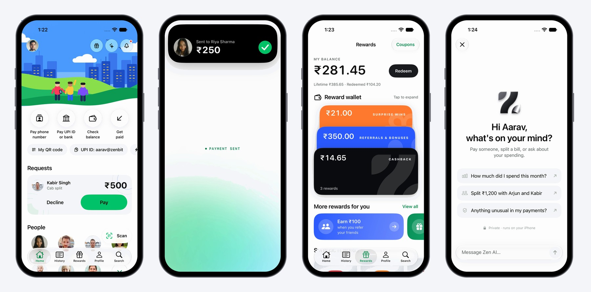

</div>

> **Concept app.** All people, balances, payments and offers are sample data. No bank is connected, no money moves, and no user data is collected.

[Why it works](#why-it-works) · [Screens](#screens) · [UI decisions](#ui-decisions-i-made) · [Built with SwiftUI](#built-with-swiftui) · [Advertising](#how-advertising-works) · [Business](#how-the-business-works) · [Data](#data-what-is-measured) · [Revenue model](#revenue-model-illustrative) · [Run it](#run-it)

---

## Why it works

Payment apps lose trust in two places: the moment of paying, and the clutter around it. Zenbit is designed around both.

| What people need | What Zenbit does | Why it works |
|---|---|---|
| "Am I paying the right person?" | Face, name and UPI ID before paying; face and amount again while sending | A face is checked faster than a string of characters |
| "Did it go through?" | A large Dynamic Island card: **Sending to** with a spinner, then **Sent to** with a green tick, a sound and a receipt | One place to look, with the result shown by words, icon, colour and sound |
| "Don't show my money to people near me" | No balance before paying. "Not enough balance" appears only **after** the PIN | The screen is safe to use in a shop queue |
| "Stop me before a mistake" | Warnings for repeated payments and suspicious requests | The check happens before the money leaves |
| "Make the common thing quick" | Suggested amount, Face ID, favourites, widgets | Paying someone again takes 3 taps from Home |
| "Keep ads out of my way" | Ads are labelled and never appear in the pay flow or receipt | The business earns without getting between a person and their payment |

<div align="center">
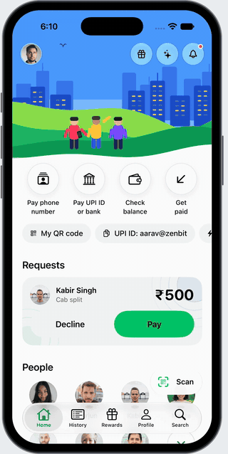
<br><sub>A full simulated payment. Full-quality 60 fps recordings are in <a href="recordings">recordings/</a>.</sub>
</div>

---

## Videos

iPhone and Apple Watch mock-ups made from simulator recordings ([watch them on the showcase](https://zenbit-nine.vercel.app/#film)).

| Payment | Apple Watch |
|---|---|
| [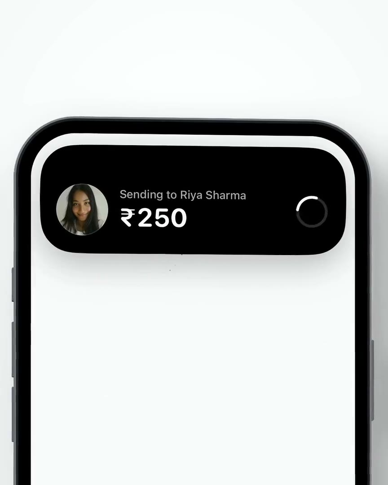](docs/media/mock/payment.mp4) | [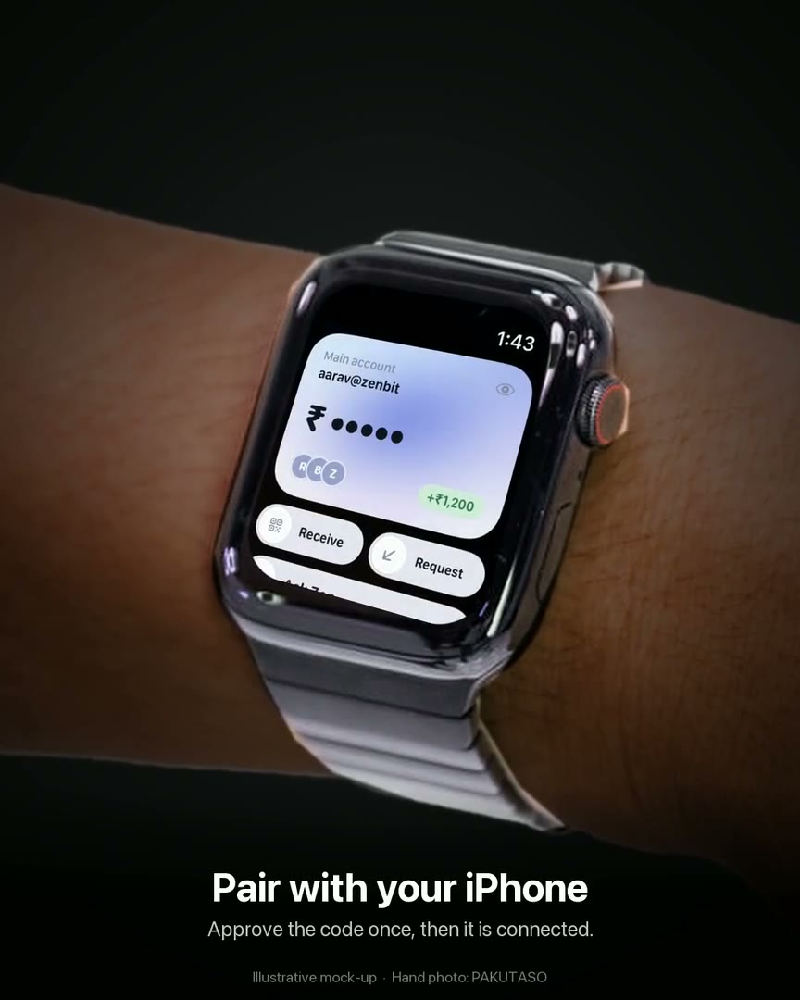](docs/media/mock/watch.mp4) |

Also: [sign up](docs/media/mock/signup.mp4) · [launch and home](docs/media/mock/home.mp4) · [rewards](docs/media/mock/rewards.mp4) · [Zen AI](docs/media/mock/zen-ai.mp4). Hand photo: [PAKUTASO](https://www.pakutaso.com).

---

## Screens

### Paying
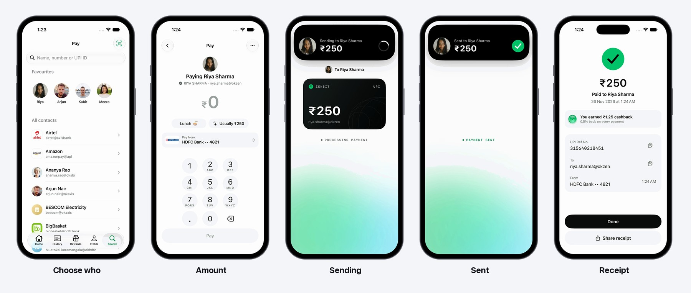

### Getting started
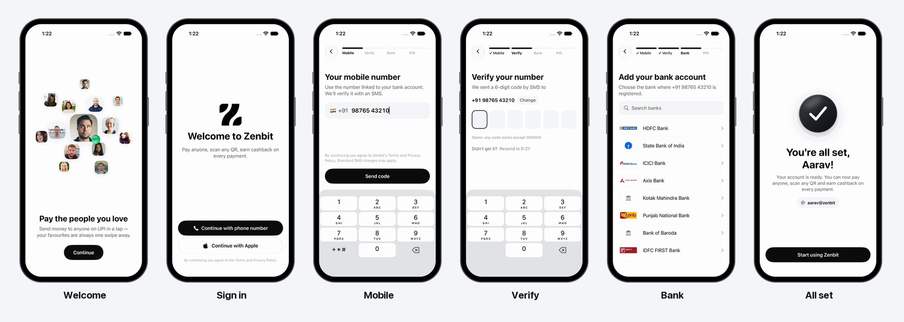

### Home and activity
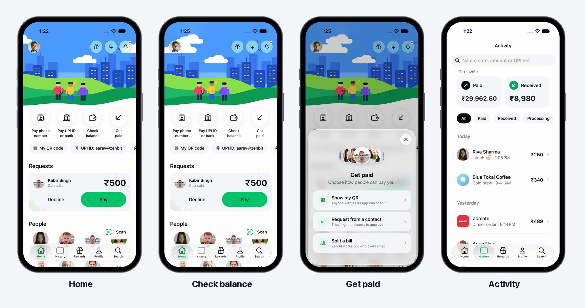

### Rewards
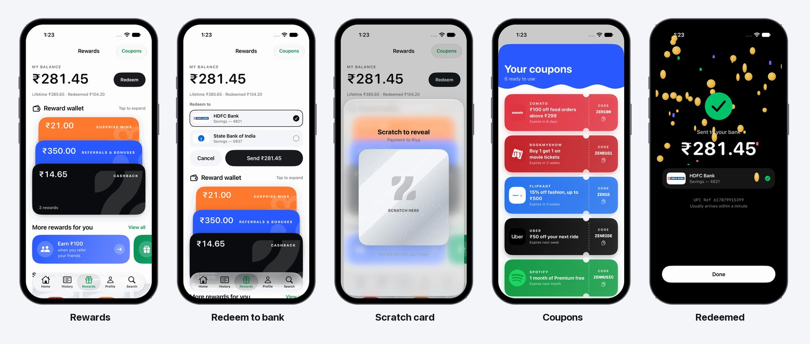

### Zen AI, profile and Watch pairing
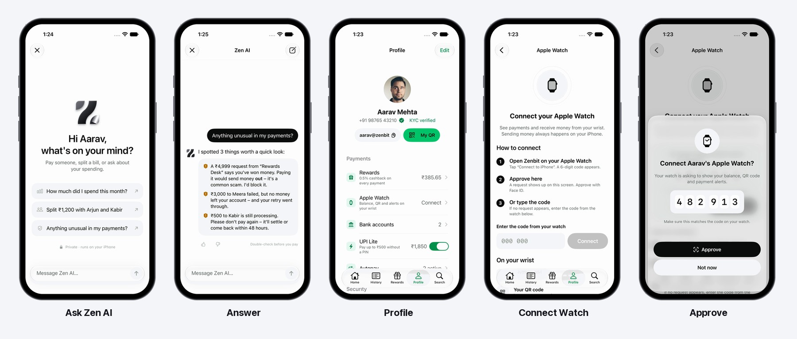

### When things go wrong
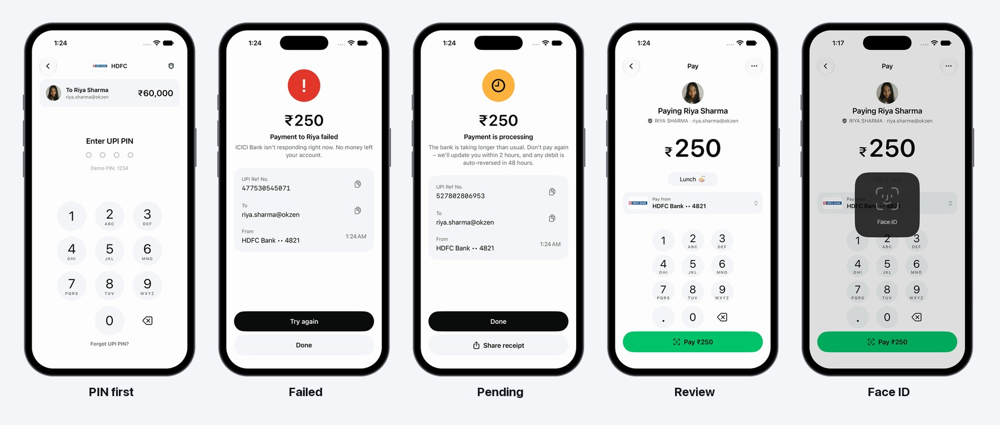

### Loading states
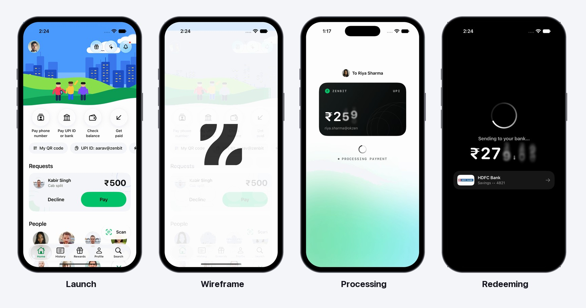

### Apple Watch
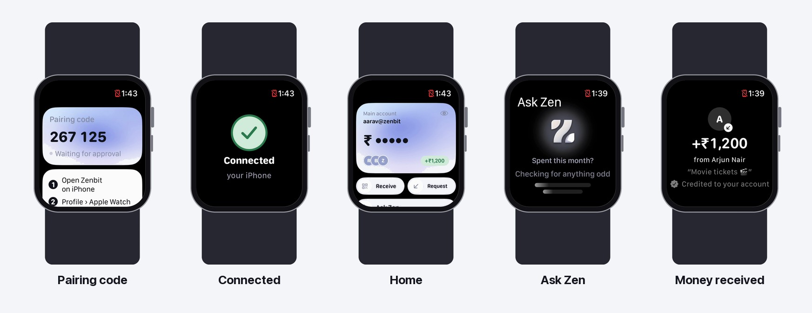

### Widgets
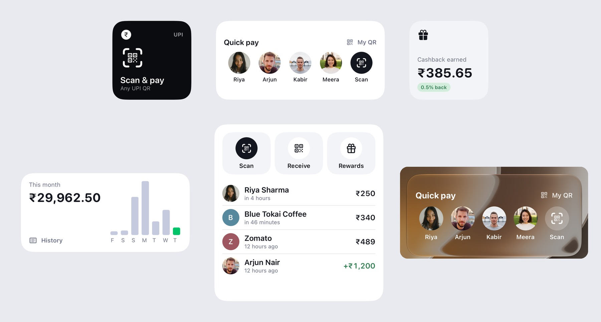

Widgets put actions first and never show a bank balance. On Clear and Tinted Home Screens they switch to high-contrast white and keep faces in full colour (bottom right).

---

## UI decisions I made

These are the calls I made while reviewing builds, and why each one holds up.

| My decision | What changed | Why it works |
|---|---|---|
| **My own Z mark, in Apple's glass style** | Glass app icon; plain white launch with a still black logo, no launch trick | The brand is recognisable and the app feels quick to open |
| **Black for actions, green for money** | Buttons are black. Green is kept for paying, receiving, success, scan and the selected tab | When green appears, it means something |
| **Remove the extra "+₹50" chip** | A cleaner home header | One less thing competing with the main actions |
| **A small see-through Scan button with a green icon** | Narrow floating pill instead of a solid block | Scan stays in reach without hiding content |
| **Simple sign-up** | No Google sign-in; labelled step bar; proper OTP boxes and PIN screens | People know where they are and how much is left |
| **A real iOS-style number pad** | Round keys with letters, even spacing | It behaves the way iPhone users already expect |
| **Real bank and merchant logos, smaller "Pay from" card** | Logos instead of placeholders; less text | Banks are picked by sight, and the amount stays the focus |
| **Privacy first for low balance** | The message moved to after the PIN | Nobody nearby learns that the balance is low before the owner confirms |
| **A circular loader** | One clear spinner for bank and server waits | Waiting looks intentional, not frozen |
| **Rewards that feel like a wallet** | Stacked cards, scratch cards, ticket coupons in brand colours, bank picker beside Redeem, sound and confirmation | Rewards are easy to scan and redeeming feels finished |
| **A calm, black-and-white Zen AI** | Removed the orb and border effects; flowing monochrome waves and the Z mark | The AI looks focused, and colour stays meaningful elsewhere |
| **A simple, colourful home scene** | Flat colours, buildings and people; no sun | Warm without distracting from paying |
| **A simpler "All set" screen** | Rejected the stacked-card version for one animated tick | The moment is clear in a second |
| **Ads only in the free space** | A one-line ad appears when the tab bar shrinks on scroll, and leaves when you scroll back | No content is pushed away to make room |
| **Clean charts** | Fixed overlapping labels | Numbers are only useful if they can be read |
| **Flat black Apple Watch, plain widgets** | Plain backgrounds, light cards | Readable at a glance on a small screen |
| **A bigger payment island** | Large photo, name, amount and a green tick | The two facts that matter, who and how much, come first |
| **Readable widgets on Clear Home Screens** | Bolder text, soft icon plates, full-colour faces | Glass looks good only if the text can still be read |
| **Real captures in Figma** | Kept the real screens instead of redrawn copies | The design file matches what was built |

---

## Built with SwiftUI

The whole interface is written in **SwiftUI**: iPhone, Apple Watch, widgets and the Live Activity, about 13,000 lines of Swift.

| Part | Built with | What it gives the product |
|---|---|---|
| Interface and motion | SwiftUI, springs, `TimelineView`, `Canvas`, mesh gradients | Native feel; the payment dissolve is drawn live |
| Navigation | iOS 26 Liquid Glass tab bar with a bottom accessory | The system tab bar shrinks on scroll and makes room for one ad |
| Dynamic Island and Lock Screen | ActivityKit | The same payment status inside and outside the app |
| Home Screen and Control Center | WidgetKit | Scan or pay without opening the app first |
| Apple Watch | SwiftUI for watchOS, WatchConnectivity | Pairing with a 6-digit code approved on the iPhone |
| Zen AI | Apple Foundation Models on device where available, with built-in answers otherwise | Questions about sample spending are answered on the phone |
| Sound and touch | AVFoundation, haptics | Success can be heard and felt, and follows the silent switch |

**Design system:** [Figma file](https://www.figma.com/design/krbWrsbpPXzNV9TtVSxwva/Zenbit-new) with colour, spacing and radius tokens, text styles, components, patterns and all screens. Tokens are also in [`figma/tokens`](figma/tokens).

---

## How advertising works

Each ad is **built by the app from a small record**. No ad network or image generator is connected today.

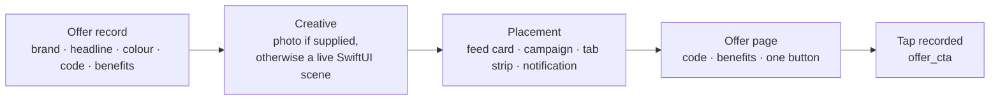

### The creatives
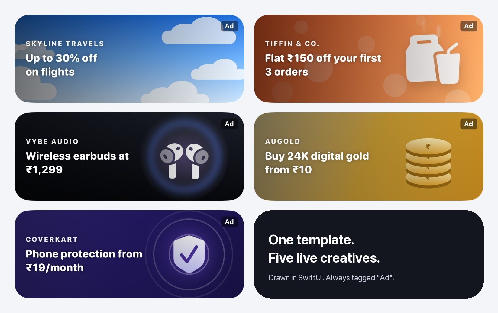

A flight ad has gliding clouds, food has steam and soft light, earbuds sit in a rotating ring, gold coins shimmer and the insurance shield pulses. If a licensed photo is added for an offer, the same layout uses it with a slow zoom ([photo brief](apple/AD_PHOTOS.md)). The five brands above are fictional.

### Where they appear
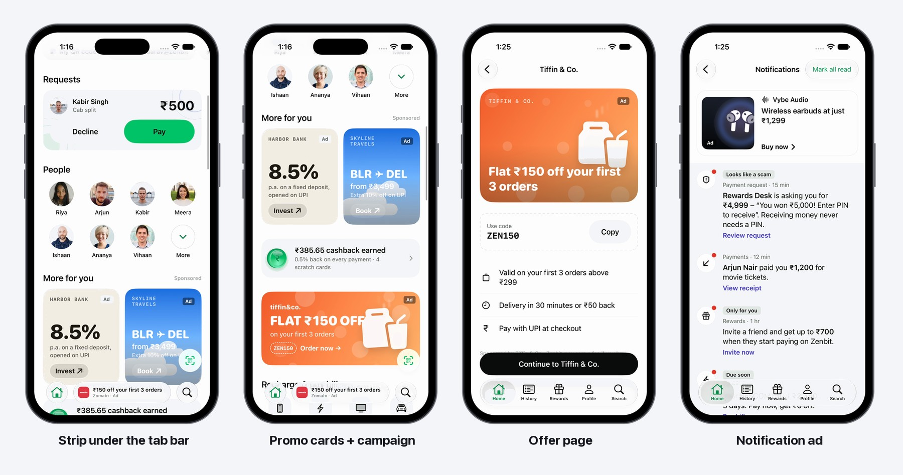

### Why it works for both sides

| Rule | For the person | For the business |
|---|---|---|
| Every ad says **Ad** or **Sponsored** | No confusion with real payments | Trust protects long-term clicks |
| Never in the pay flow or receipt | Nothing interrupts money moving | Fewer risks of mistaken taps and complaints |
| Offers connect to paying | A code or benefit is usable straight away | The offer sits next to the moment of spending |
| Ads use their own art and colours | They are easy to tell apart from app controls | Creatives still look premium |
| One template, many creatives | Consistent, calm layout | A new offer needs a record, not a new screen |

---

## How the business works

Sending money person to person over UPI earns **nothing**. Paying is what brings people back every day; the money comes from useful services around it.

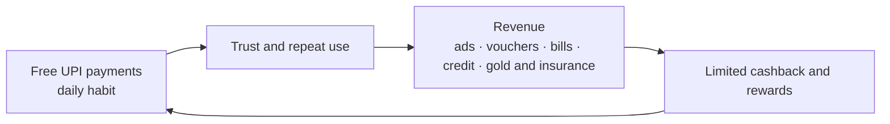

| Stream | Who pays | Why they would pay |
|---|---|---|
| Sponsored ads | Brands | Reach people at a moment when they are spending |
| Brand-funded vouchers | Brands | They fund the discount and get a new customer |
| Bills and recharges | Billers and aggregators | A commission for each completed bill, where offered |
| Credit on UPI | Lending and card partners | New borrowers or card users |
| Gold and insurance referrals | Providers | A referral fee for each sale |

These are **planned** streams. No partner is signed, and each would need commercial agreements and regulatory checks.

---

## Data: what is measured

**Today:** the app has event hooks that write to the **device's system log only**. There is no analytics service and no server, so nothing is sent anywhere and there is no user data to report.

| Area | Events in the code | Question it can answer |
|---|---|---|
| Sign-up | `onboarding_step`, `onboarding_complete` | Where do people stop? |
| Paying | `pay_flow_start`, `amount_confirmed`, `payment_result` | How many payments start and finish? |
| Security | `pin_ok`, `pin_wrong`, `faceid` | Is approval working smoothly? |
| Scan | `scan_ok`, `scan_invalid` | How often does scanning fail? |
| Offers | `offer_cta`, `card_apply` | Which offers get tapped? |
| Zen AI | `ai_prompt`, `ai_suggestion_used`, `ai_feedback` | Is the assistant useful? |
| Other | `widget_open`, `request_sent`, `copy` | Which shortcuts are used? |

**Not measured yet:** number of taps, time spent on each step, effort per task and ad impressions. A real launch needs these (with consent) before any effort or ad-revenue number can be real:

| Planned measure | How | What it improves |
|---|---|---|
| Taps per completed task | Count taps between a task's start and end events | Removes extra steps |
| Time per step | Timestamp each funnel event | Finds the slow screen |
| Drop-off | Compare consecutive funnel steps | Finds where people give up |
| Ad impressions and tap rate | Count ads that were actually on screen | Needed for honest ad revenue |

**Privacy rules:** never record the UPI PIN, balances, amounts, UPI IDs or names; ask for consent; let people turn analytics off.

### Effort today: taps
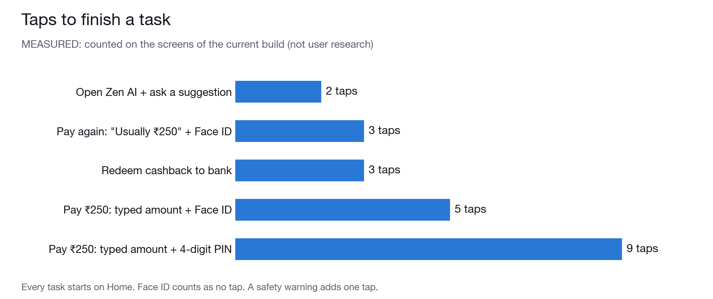

These are counts of the taps the current screens require. They are not measurements of real people.

### Effort today: time
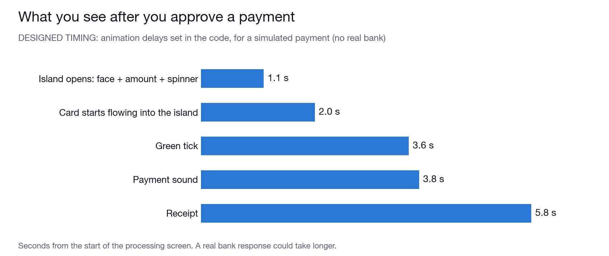

---

## Revenue model (illustrative)

> **These are not results.** Zenbit has no users or revenue. The charts show how the business would behave **if** the assumptions below were true. Change an assumption and the answer changes.

| Per monthly active user | Assumption | ₹ per month |
|---|---|---|
| Sponsored ads | 90 impressions × ₹60 per 1,000 | 5.40 |
| Credit on UPI | 4% of users spend ₹10,000; 1% share | 4.00 |
| Brand-funded vouchers | 0.3 redemptions × ₹10 | 3.00 |
| Bills and recharges | 1.5 bills × ₹2 | 3.00 |
| Gold and insurance referrals | 1% of users × ₹150 | 1.50 |
| **Total** | | **16.90** |

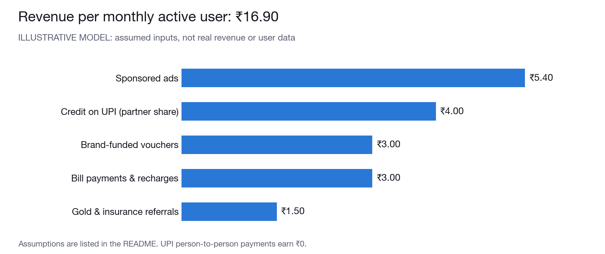

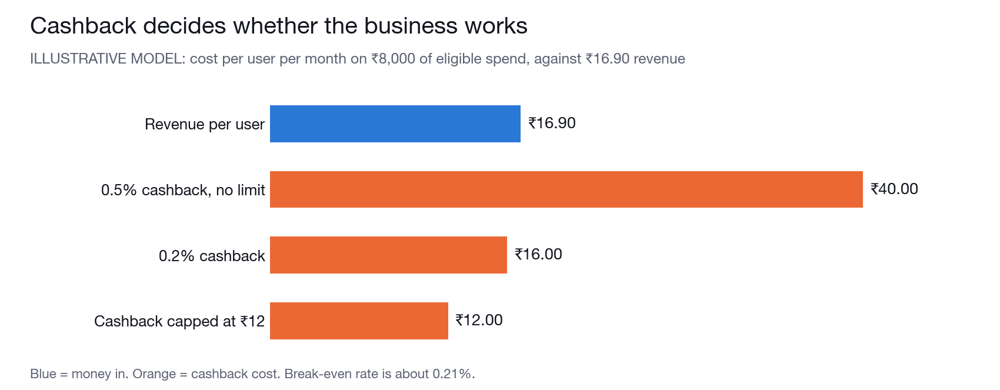

**The key finding:** the app currently shows **0.5% cashback on every payment**. On ₹8,000 of eligible spend that costs ₹40 a user, far more than the ₹16.90 earned. Under these assumptions, a launch should **cap** cashback (for example ₹12 a month), fund bigger rewards through brands, or keep the rate below about **0.21%**.

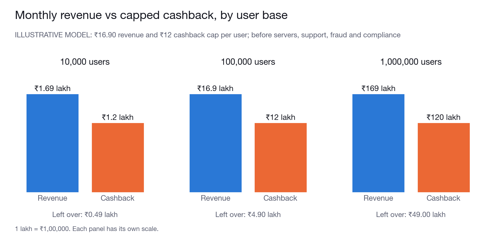

What is left over still has to pay for servers, banking partners, support, fraud losses, compliance, marketing and the team. This is not a profit forecast.

---

## Run it

Requires a Mac with Xcode and the iOS 26.1 SDK or newer.

```bash
open apple/ZenbitPay.xcodeproj
```

Choose the **ZenbitPay** scheme and an iPhone simulator, then press Run. To run on a real iPhone, select your own signing team. The project can be regenerated from `apple/project.yml` with XcodeGen.

## What is in this repo

| Folder | Contents |
|---|---|
| [`apple/`](apple) | SwiftUI app for iPhone and Apple Watch, widgets, Live Activity |
| [`figma/`](figma) | Design tokens, screen captures and notes |
| [`videos/`](videos) | Original screen recordings from iPhone and Apple Watch, with no mock-ups |
| [`recordings/`](recordings) | The main flows inside a simple device frame |
| [`docs/`](docs) | The showcase web page and the images used here |

The earlier web and Expo prototypes were removed from the current files; they remain in the Git history.

## Notes and credits

- Not affiliated with NPCI, UPI, Apple, any bank or any merchant. Bank and merchant logos are trademarks of their owners, shown only to illustrate a concept ([credits](apple/Shared/Brands-CREDITS.md)).
- Most contact portraits are demo placeholders from randomuser.me and must be replaced before any release.
- Sounds: [credits](apple/iOS/Resources/Sounds/CREDITS.md).
- Some images and recordings were captured before the latest visual tweaks, and the recordings have no sound.
